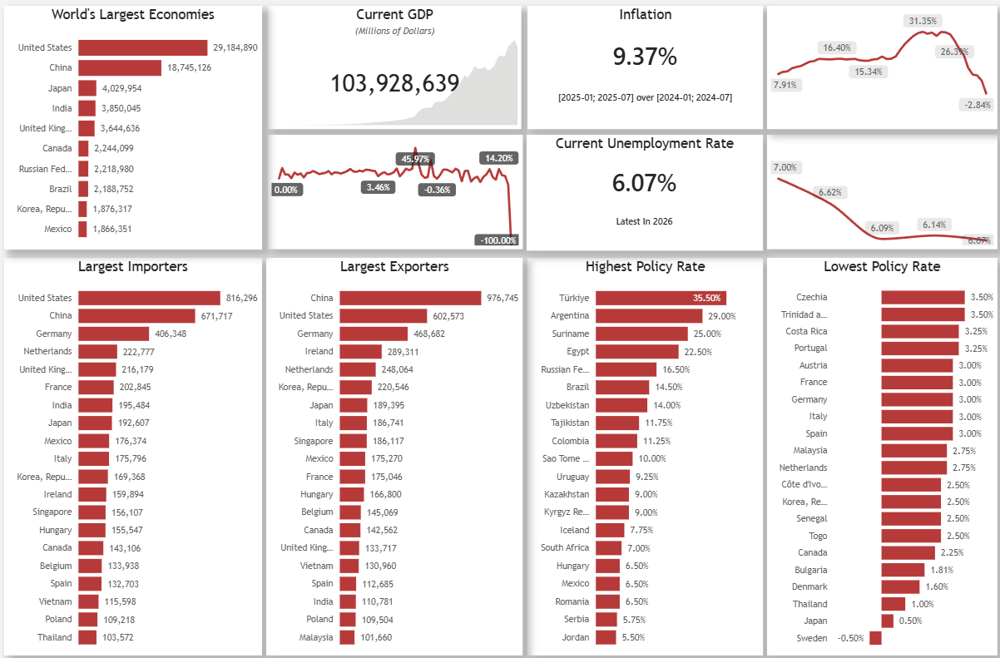
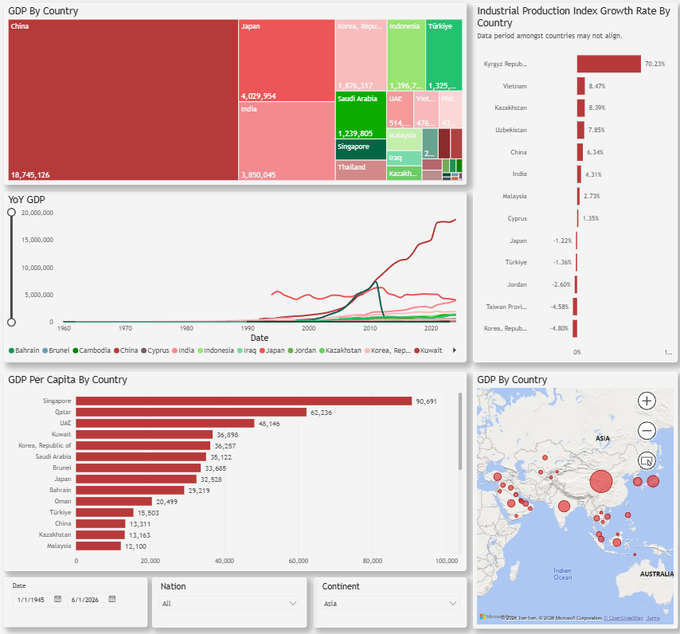
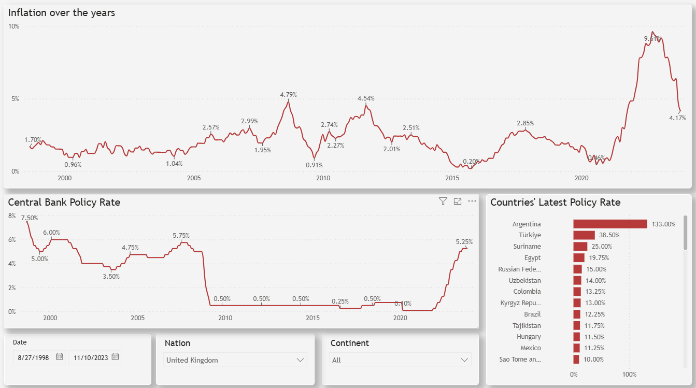
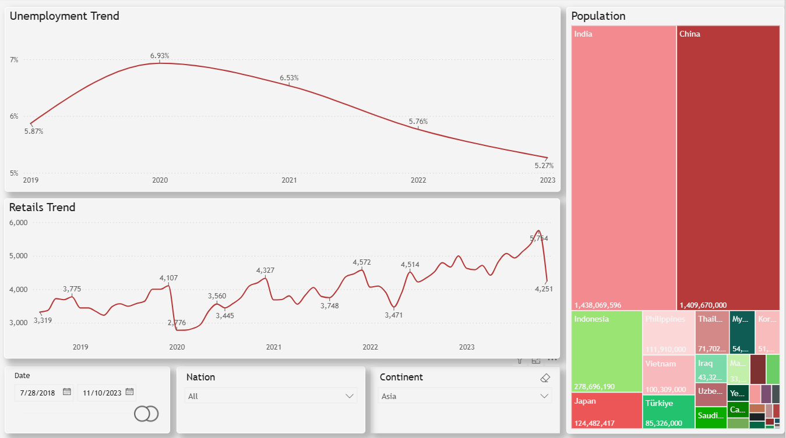
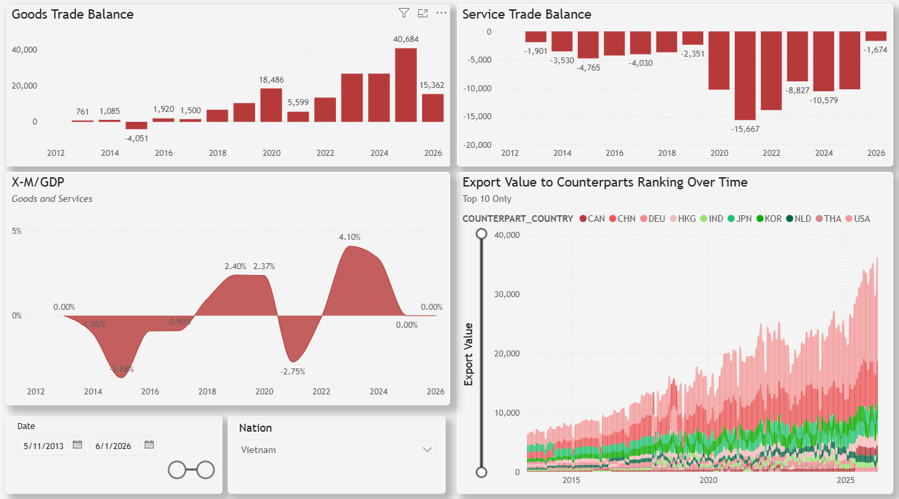

# jobs-run

Airflow (Python 3.11, LocalExecutor) running in Docker, with a separate Postgres database for
business/application data and pgAdmin for browsing both databases. The DAGs populate the business
database that feeds the **World Economy Monitor** Power BI report (`powerbi/World Economy
Monitor.pbip`) — see [Data Sources](#data-sources) and [Power BI Report](#power-bi-report) below.

## Prerequisites

- Docker Desktop

## Setup

1. Copy the environment template and fill in real values:

   ```bash
   cp .env.example .env        # bash / Git Bash
   Copy-Item .env.example .env # PowerShell
   ```

   `.env` is gitignored — it holds local secrets and is never committed. See
   [Environment variables](#environment-variables) below for what each value means and where to
   get it.

2. Build and start everything:

   ```bash
   docker compose up -d --build
   ```

3. Access points:

   | Service | URL | Login |
   |---|---|---|
   | Airflow UI | http://localhost:8080 | `_AIRFLOW_WWW_USER_USERNAME` / `_AIRFLOW_WWW_USER_PASSWORD` from `.env` (default `airflow` / `airflow`) |
   | pgAdmin | http://localhost:5050 | `PGADMIN_DEFAULT_EMAIL` / `PGADMIN_DEFAULT_PASSWORD` from `.env` (default `admin@example.com` / `admin`). Both Postgres servers are pre-registered — DB password on first connect is `airflow`/`airflow` or `business`/`business` by default. |
   | Business Postgres | `localhost:5433` (host) / `postgres-business:5432` (from other containers) | `BUSINESS_POSTGRES_*` from `.env` |

## Environment variables

| Variable | Purpose | Where to get it |
|---|---|---|
| `AIRFLOW_UID` | Host UID Airflow's containers run as. Leave at `50000` unless you know you need otherwise. | — |
| `AIRFLOW_FERNET_KEY` | Encrypts Connection passwords in Airflow's metadata DB. Blank is fine for local dev. | `python -c "from cryptography.fernet import Fernet; print(Fernet.generate_key().decode())"` |
| `AIRFLOW_WEBSERVER_SECRET_KEY` | Signs Airflow's session cookies. | Any random string; change before non-local use. |
| `_AIRFLOW_WWW_USER_USERNAME` / `_AIRFLOW_WWW_USER_PASSWORD` | Airflow UI admin login, created on first `docker compose up`. | Pick your own. |
| `BUSINESS_POSTGRES_USER` / `_PASSWORD` / `_DB` / `_PORT` | Credentials and host port for the business Postgres instance. | Pick your own. |
| `PGADMIN_DEFAULT_EMAIL` / `_PASSWORD` / `_PORT` | pgAdmin's own login and host port. | Pick your own. |
| `IMF_API_KEY` | Required by `dags/utils.py`'s `fetch_imf_api()` and everything built on it (`fetch_ipi`, `fetch_policy_rate`, `fetch_weo`, `fetch_bop_services`, `fetch_imts`) — DAGs that call those (`ipi_data`, `cb_policy_rate_data`, `population_data`, `merchandise_imports_data`, `merchandise_exports_data`, `trade_in_services_data`) fail without it. Not needed for DAGs that only use DBnomics (`fetch_series` / `fetch_imf_data` / `fetch_imf_bulk`), e.g. `fetch_exchange_rate`, `gdp_data`, `cpi_data`, `unemployment_data`, `retail_sales_data`, `global_manufacturing_pmi_data`, `country_mapping`. | Register for a free key at https://portal.api.imf.org/ |

## DAGs

| DAG id | File | What it does |
|---|---|---|
| `country_mapping` | `dags/country_mapping.py` | Builds ISO2/ISO3/continent reference data, writes `country_mapping`. Run this before `ipi_data` and `cb_policy_rate_data`, which join against it. |
| `fetch_exchange_rate` | `dags/fetch_exchange_rate.py` | Pulls monthly USD exchange rates (IMF/IFS via DBnomics) into `exchange_rate`. Run before `gdp_data`, which joins against it. |
| `gdp_data` | `dags/gdp.py` | Pulls annual GDP (IMF/IFS via DBnomics), converts to USD using `exchange_rate`, writes `gdp_data`. |
| `ipi_data` | `dags/ipi.py` | Industrial Production Index: prefers IMF's direct API per country, falls back to DBnomics for countries it doesn't cover. Reads `country_mapping` to attach ISO2 codes/names. Writes `ipi_data`. |
| `cpi_data` | `dags/cpi.py` | Headline Consumer Price Index (IMF/CPI via DBnomics), writes `cpi_data`. |
| `cb_policy_rate_data` | `dags/cb_policy_rate.py` | Central bank policy rate: prefers IMF's direct API, falls back to BIS (via DBnomics) for the Eurozone, UK, Saudi Arabia, Kuwait. Reads `country_mapping`. Writes `cb_policy_rate_data`. |
| `unemployment_data` | `dags/unemployment.py` | Unemployment rate (IMF WEO via DBnomics), writes `unemployment_data`. |
| `retail_sales_data` | `dags/retail_sales.py` | Retail sales value (OECD/MEI via DBnomics, two measures blended across country groups), writes `retail_sales_data`. |
| `population_data` | `dags/population.py` | Population, including forecast years (IMF's direct WEO API), writes `population_data`. |
| `merchandise_exports_data` | `dags/merchandise_exports.py` | Merchandise exports, FOB valuation, bilateral by real counterpart country (IMF's direct IMTS API), writes `merchandise_exports_data`. |
| `merchandise_imports_data` | `dags/merchandise_imports.py` | Merchandise imports, FOB valuation with CIF fallback per country that doesn't report FOB (IMF's direct IMTS API), writes `merchandise_imports_data`. |
| `trade_in_services_data` | `dags/trade_in_services.py` | Trade in services, exports and imports (IMF's direct BOP API, quarterly data split evenly into monthly), writes `trade_in_services_exports` and `trade_in_services_imports`. |
| `global_manufacturing_pmi_data` | `dags/global_manufacturing_pmi.py` | Global manufacturing PMI / business confidence index (OECD/MEI via DBnomics), writes `global_manufacturing_pmi_data`. |

Shared fetch/DB helpers live in `dags/utils.py` (`get_business_db_engine`, `replace_table`,
`log_job_run`, plus the IMF/DBnomics fetch functions). Country reference lists live in
`dags/config.py`.

## Data Sources

Data is sourced from two pipelines — **DBnomics** (the `dbnomics` Python package, a free
aggregator mirroring IMF/OECD/BIS series) and the **direct IMF API** (`api.imf.org`, SDMX 3.0),
used where DBnomics' mirror has gaps or lag. The direct API requires a free key from
`portal.api.imf.org`, stored in `.env` as `IMF_API_KEY` (see
[Environment variables](#environment-variables) above).

The indicators are organized into 4 pillars:

| Pillar | Focus | Goal | Indicators | Data Source | DAG |
| :--- | :--- | :--- | :--- | :--- | :--- |
| **Pillar 1** | System Health & Growth | Identify the economic cycle (expansion vs. recession) | Real GDP (local currency, converted to USD)<br>Industrial Production Index (IPI) | DBnomics `IMF/IFS` (`NGDP_XDC`) merged with `IMF/IFS` exchange rate (`EDNA_USD_XDC_RATE`)<br>IMF API `IMF.STA:PI` (`IND`), falling back to DBnomics `IMF/IFS` (`AIP_IX`) for the ~15 countries the IMF PI dataflow doesn't cover (e.g. UK, Belgium, Sweden) | `gdp_data` (+ `fetch_exchange_rate`)<br>`ipi_data` |
| **Pillar 2** | Inflation & Monetary Policy | Track price pressure and investment flow direction | Headline Consumer Price Index (CPI)<br>Central Bank Policy Rate | DBnomics `IMF/CPI` (`PCPI_IX`, monthly)<br>IMF API `IMF.STA:MFS_IR` (`MFS166_RT_PT_A_PT`, broadest country coverage), falling back to DBnomics `BIS/WS_CBPOL` for countries MFS_IR doesn't report individually (Eurozone members — ECB sets one shared rate — plus UK, Saudi Arabia, Kuwait) | `cpi_data`<br>`cb_policy_rate_data` |
| **Pillar 3** | Labor & Consumption | Assess real consumer purchasing power | Unemployment Rate<br>Retail Sales Growth<br>Population (used for per-capita metrics) | DBnomics `IMF/WEO:latest` (`LUR`, % of total labor force)<br>DBnomics `OECD/MEI` (`SLRTTO02`, monthly retail trade value)<br>IMF API `IMF.RES:WEO` (`LP`), includes forecast years alongside actuals | `unemployment_data`<br>`retail_sales_data`<br>`population_data` |
| **Pillar 4** | Trade & Supply Chain | Measure trade flows and geopolitical shocks | Merchandise Imports / Exports<br>Trade in Services<br>Global Manufacturing PMI | IMF API `IMF.STA:IMTS` (exports `XG_FOB_USD`; imports try `MG_FOB_USD`, fall back to `MG_CIF_USD` per-country) — fetched bilaterally by real ISO3 counterpart country and summed, avoiding regional aggregate codes (`G001`, `GX170`, etc.) that would double-count totals<br>IMF API `IMF.STA:BOP` (indicator `S`, credits `CD_T` / debits `DB_T`), quarterly, evenly split into monthly<br>DBnomics `OECD/MEI` (`BSCICP02`, Business Confidence Index) | `merchandise_exports_data`<br>`merchandise_imports_data`<br>`trade_in_services_data`<br>`global_manufacturing_pmi_data` |

### Supplementary Data

**Country Reference Data**: country/continent mapping built locally from `dags/config.py`
(`dict_2_char` / `dict_3_char`) — no external API. Continent is assigned offline via the
`pycountry_convert` library, with manual overrides in `dags/utils.py` for the handful of codes it
doesn't recognize (historical entities like the former USSR, special territories). DAG:
`country_mapping`.

Commodity Price Index (planned for Pillar 4) and the US Deep-Dive (CPI, Unemployment, Nonfarm
Payrolls, Real GDP, Manufacturing Investment via FRED) are not yet implemented as DAGs in this
repo.

## Power BI Report

The report (`powerbi/World Economy Monitor.pbip`) has 9 pages: 5 content pages and 4 drill-through
tooltip pages. Its semantic model reads directly from the business Postgres database populated by
the DAGs above (each table's partition is a `PostgreSQL.Database("localhost:5433", "business")`
native query, e.g. `SELECT * FROM gdp_data`) — no manual CSV export/import step.

| Page | Description |
| :--- | :--- |
| **Overview** | A top-down global snapshot — headline KPIs (GDP, CPI, unemployment, policy rate, trade, industrial production, retail sales) blended across all tracked countries, with current-vs-previous month/year comparisons. The starting point for reading the state of the world economy at a glance. |
| **Economic Growth** | Compares GDP levels and growth rates across countries and time — map, treemap, and per-capita/growth combo chart — to surface which economies are expanding, contracting, or over/under-sized relative to population. |
| **Inflation & Monetary Policy** | Places inflation (YoY CPI) and central bank policy rates side by side, by country and over time, to see how monetary policy is responding to price pressure. |
| **Labor & Consumption** | Reads consumer-side health through unemployment and retail sales trends alongside population, to gauge real purchasing power and labor market slack. |
| **Global Trade** | Breaks merchandise and services trade apart — goods vs. services trade balance by year, plus a ribbon chart of top trading partners over time — showing what the combined trade figures on Overview hide. |

### Sample Screenshots

**Overview**


**Economic Growth**


**Inflation & Monetary Policy**


**Labor & Consumption**


**Global Trade**


### Semantic Model

Key fact tables loaded into the model: `f_gross_domestic_product`, `f_industrial_production_index`,
`f_consumer_price_index`, `f_cb_policy_rates`, `f_unemployment_rate`, `f_retail_sales`, `f_PMI`,
`f_trade_balance`, `f_imf_imports_goods`, `f_imf_exports_goods`, `f_imf_imports_services`,
`f_imf_exports_services`, `imf_population`, plus `d_country` and `d_calendar` as dimension tables
and a central `Measures_Table` for DAX measures.

## Useful commands

Test a single task without going through the scheduler (fast feedback loop, prints output to
your terminal):

```bash
docker compose exec -T airflow-scheduler airflow tasks test <dag_id> <task_id> <YYYY-MM-DD>
```

Check for DAG parse errors:

```bash
docker compose exec -T airflow-scheduler airflow dags list-import-errors
```

Query the business database directly:

```bash
docker compose exec -T postgres-business psql -U business -d business
```

Stop everything:

```bash
docker compose down
```

## Dependencies

- `requirements.txt` — installed into the Airflow image, used by DAG code at runtime. Kept
  unpinned for direct dependencies only; installed against Airflow's own constraints file so
  transitive versions stay compatible with Airflow itself (see `Dockerfile`).
- `requirements-dev.txt` — local-only tooling (Jupyter, pytest, etc.), not installed in the image.
